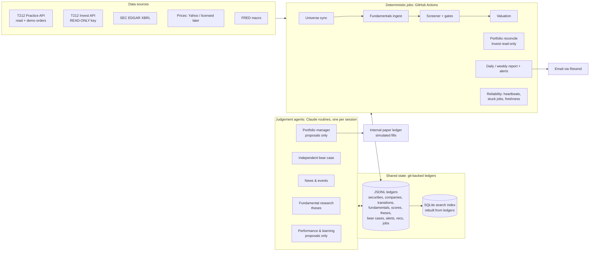

# Investment research system: audit, target architecture and plan

Audit date **2026-10-14** (branch `claude/trading212-agent-skills-r71zy3` at `2a4305e`, plus the Milestone 1 work
in this commit). "Verified" means observed directly in this session: an API response, a test run, a git commit
or a routine record. A config file or schedule existing is not treated as proof that anything works.

---

## 1. What exists and has been verified

| Component | Where | Verified status | Evidence |
|---|---|---|---|
| Trading 212 API client (demo-locked, rate limits, non-retried order POSTs) | `trading/t212bot/client.py` | **Operational (Practice only)** | Read-only calls returned account 51806610 today; hard-coded to `demo.trading212.com` |
| Read-only facade (no order methods reachable) | `trading/t212bot/readonly.py` | **Operational** | Allowlist of 8 GET methods; tested |
| Demo trading bot (rebalancer, executor, journal, reconcile) | `trading/t212bot/` | **Operational** | 139/139 tests pass; ops run committed `2142658` today; first LQQ3 trade journalled |
| Discretionary intraday mode (owner override, 2026-10-14) | `trading/t212bot/decide.py`, `strategy.json` | **Active** | `strategy.json` mode `discretionary`, universe of 5 ETPs incl. 3x leveraged |
| Hourly read-only monitor | `trading/t212bot/monitor.py`, `monitor_run.sh` | **Partially operational** (see §4) | Commits at 07:57, 08:58, 12:58 UTC; no commit for 09:57, 10:57 or 11:57 |
| Daily intelligence report + Resend email | `trading/t212bot/intel.py`, `emailer.py` | **Works when run by hand; not scheduled** | Real delivery `confirmed_delivered` 2026-10-13; no report exists for 2026-10-14 |
| Independent report-vs-account verifier | `trading/t212bot/verify.py` | **Operational** | 37/37 checks passed 2026-10-13 |
| Withdrawal adviser (recommendation only) | `trading/t212bot/adviser.py` | **Operational, conservative** | Returns £0 by default |
| Shadow portfolios (benchmarks at daily closes) | `trading/t212bot/shadow.py` | **Operational** | Tested; A/D/E/C shadows configured |
| Quant research loop (pre-registration, OOS, bootstrap, deflated Sharpe, promotion gate) | `research/` | **Operational** | 15 experiment records; scheduled runs committed at 00:18, 12:59 and 13:25 UTC today |
| **Master Stock Screener** (FCF/share 30, quality 25, growth 20, valuation 20, risk fit 5) | — | **Missing.** No code, config or record of it exists in the repository. | `grep` for screener/FCF/ROIC/DCF: no matches before this milestone |
| Company database / discovery pipeline | — | **Missing before this milestone** (Milestone 1 adds the foundation, §7) | — |
| Valuation (DCF, reverse DCF, multiples) | — | **Missing** | — |
| Options, microstructure, institutional data | — | **Missing; no data source available** | §3 |
| Portfolio risk engine (factor, correlation, scenario) | — | **Missing** (the monitor has drawdown and intraday-move checks only) | — |
| Performance and learning (recommendation outcomes, calibration) | partial: `research/` for strategies, `performance.py` for the account | **Partial**: strategy-level only, no per-recommendation tracking | — |

## 2. Account connections

| Account | Configured? | Verified identity | Notes |
|---|---|---|---|
| **Trading 212 Practice (demo)** | Yes (`T212_API_KEY/SECRET`, `T212_ENV=demo`) | Account **51806610**, GBP, total £489.77, cash £31.56, one position (1.355 LQQ3l_EQ), 0 pending orders (read 2026-10-14 ~13:40 UTC) | Being traded hourly by the discretionary routine |
| **Trading 212 Invest (live)** | **No** | — | No credentials exist. The client refuses any host but demo. **Monitoring your real portfolio is blocked until you supply a read-only Invest key (§8).** |
| Trading 212 ISA | No | — | The API cannot tell ISA from GIA; the adviser assumes GIA |
| Internal simulated (paper) portfolio for stock picks | No | — | The `shadow.py` engine is ETF-allocation only. Plan: §6, Phase 5 |

The live (Invest) host was **not** contacted at any point.

## 3. Data sources: verified access, limits and gaps

| Source | Access verified 2026-10-14 | Provides | Limits / licensing |
|---|---|---|---|
| Trading 212 `/equity/metadata/instruments` | 200 | 18,473 instruments, **100% with ISIN**; 12,167 stocks (USD 6,949 · EUR 3,141 · GBX 1,400 · CAD 542 · CHF 134) | Your broker data; per-endpoint rate limits enforced client-side. No prices, no fundamentals. |
| **SEC EDGAR XBRL** (`companyfacts`, `company_tickers_exchange`, `submissions`, `frames`) | 200 with a contact User-Agent; **403 without an email in the UA** | Every annual and quarterly value filed by US registrants, with accession number and filing date (point-in-time history) | Free, public domain. ≤10 req/s (we use ≤5). US-GAAP filers only for now; **company-specific extension tags are not included** (e.g. NVIDIA's capex before FY2022 is unavailable). This also unblocks research item P6 (PEAD), previously BLOCKED on EDGAR 403s. |
| Yahoo chart API | 200 | Daily/intraday OHLCV, used by the bot | Unofficial, ~15-minute delay, no licence for redistribution; known unit-flip errors on LSE lines (cleaned) |
| Yahoo fundamentals-timeseries | 200 (intermittent empty body on the first call) | ~4–5 years of annual statements, including non-US (e.g. RMV.L) | Unofficial; no filing dates (not point-in-time). **Used only as an independent cross-check.** |
| Yahoo quoteSummary | **401** (needs a crumb) | — | Not used |
| FRED | 200 | Rates, yields, macro series | Free |
| OpenFIGI | 200 (POST) | ISIN → FIGI / exchange mapping | Free, rate-limited without a key; not yet integrated |
| Financial Modeling Prep, LSEG, Daloopa, Bigdata.com | 401 / connector not authorised / failed to connect | — | Would need a paid key or connector authorisation |
| Options chains, order-book depth, short interest, institutional holdings | **None available** | — | Needs a licensed provider (§6, Phase 7 decision) |

Nothing here is Bloomberg-equivalent. Fundamentals coverage today is **US SEC filers only**.

## 4. Scheduling: what actually runs

All three enabled routines fire into **one persistent session** (`session_01F4uFy8TB6eMUyemT5Ba7e8`). A routine's
`last_run: SUCCEEDED` only means the wake was *delivered*; the evidence that work ran is the commit it pushes.

| Routine | Schedule | Evidence of execution (commits) | Assessment |
|---|---|---|---|
| T212 demo: trading ops | Weekdays 08:20 London | `ops: trading run 2026-10-14T07:21Z (rc=0)` | **Operational** |
| T212 demo: research loop | 01:13 and 13:13 London | `research:` commits 00:18, 12:59 and 13:25 UTC | **Operational** |
| T212 demo: hourly trader + monitor | :57, 07–20 London, weekdays | `monitor:` commits 07:57, 08:58, 12:58 UTC; **none for 09:57, 10:57, 11:57** | **Unreliable: 3 of 6 expected runs have no evidence.** Cause unverified; the likely one is that one shared session cannot start a new turn while it is busy. |
| Daily report + email | — | No `report:` commit; no 2026-10-14 report | **Not scheduled.** The GitHub Actions workflow was designed but never committed to `master` (0 workflows on `master`). |
| Disabled, unrelated | — | "Weekly Ledger Health-Check prospecting pass" | Not part of this system |

Failure modes seen so far: permission-classifier blocks in fresh sessions, a 403 push from an unattached session
(both 2026-10-13, since fixed), and the missed hourly runs above. There is no missed-run detector yet.

**Can the infrastructure support persistent agents?** Partly. Claude routines give hourly granularity and
judgement, but they share session capacity and use plan usage on every run. They also leave no machine-checkable
heartbeat other than commits. Deterministic jobs (data ingestion, scoring, reports, health checks) belong on
**GitHub Actions** (free cron, exit codes, failure email, secrets scoped per job). Judgement-heavy work (research
write-ups, bear cases, thesis reviews) belongs in Claude routines, and **one routine per session** so that runs don't
queue behind each other. The job ledger built in Milestone 1 gives both a common heartbeat and a stuck-job record.

## 5. Concerns to state plainly

1. **The Practice account is not currently testing a stock-picking process.** Since this morning it has been
   traded intraday by Claude in 3x leveraged ETPs. The repository's own research rejected every intraday
   approach it tested (E008, E010, E011, E012, E014). That is your call to make, and nothing here
   changes it. But it means the brief's "separate simulated strategy" needs its own internal paper ledger (Phase 5);
   it cannot reuse the demo account.
2. **Your real portfolio cannot be monitored yet**: there is no Invest key (§8).
3. **The scheduler is less reliable than the docs imply**: 3 missed hourly runs today, and the daily report is unscheduled.

## 6. Target architecture

Coordination rules: the ledgers are the only shared state. Every write is an append with a deterministic id
(idempotent retries), and concurrent appends from different jobs merge with git's `union` driver. Gates are
enforced in code, not in prompts: a company cannot reach `candidate` without a recorded bear case and adequate data
confidence. Agents propose; only rule-checked code paths change statuses, and methodology changes need your approval.

## 7. Prioritised plan

| Phase | Deliverable | Depends on | Main risks | Value |
|---|---|---|---|---|
| **M1 (done here)** | Security master (ISIN-keyed, SEC-linked), evidence-backed annual fundamentals with split handling, pipeline state machine, job ledger, search index, cross-check | — | Tag coverage gaps (measured below) | Foundation for everything |
| **M2 (built 2026-10-14, see below)** | Coverage and correctness: IFRS (`ifrs-full`) filers; a concept-coverage survey across all ~5,500 SEC companies; SIC-based industry classification with bank, insurer, REIT and SPAC templates (or exclusions); slimmer snapshots so a full-universe pass fits in git (~32 KB/company today) | M1 | XBRL inconsistency across filers | Usable data for most of the US universe |
| **M3 (built 2026-10-14, §11)** | **Master Stock Screener v1**: separate quality, growth, valuation, risk and data-confidence scores; your 30/25/20/20/5 baseline weights; mandatory gates with explained pass/fail; needs prices for valuation | M2, price source | Encoding "business quality" quantitatively; overfitting the weights | The core of your process |
| **M4 (built 2026-10-14, §12)** | Valuation: multiples, FCF yield, reverse DCF and DCF scenarios with stored assumptions; bear-case and thesis records; alerts with de-duplication | M3 | False precision in DCFs | Explainable candidates |
| **M5 (started 2026-10-14, §13)** | Internal paper portfolio for screener picks: mandate, sizing, costs, benchmark, recommendations logged before outcomes are known | M3, M4 | Too few decisions for statistics for a long time | The evidence test you asked for |
| **M6** | Invest monitoring (read-only key), exposure, concentration and correlation risk engine, daily and weekly reports on GitHub Actions | Your Invest key; M1 | Credential handling | Real-portfolio oversight |
| **M7** | Reliability agent (missed and stuck runs, freshness, reconciliation), routine split (one per session), learning agent | M1 job ledger | Scheduler limits | Trustworthy unattended running |
| **M8+** | Quant signals (factors, momentum) tested via `research/` for added information; news and events; options and microstructure **only if** you choose a licensed data provider | M3, M5 | Cost; licensing | Incremental |

Live trading is out of scope. A readiness report, a design review and your explicit authorisation are preconditions,
and none is close.

## 8. Decisions and permissions needed from you

1. **Invest monitoring:** create a Trading 212 **Invest** API key with **read-only permissions only**, and add it as
   `T212_INVEST_API_KEY` / `T212_INVEST_API_SECRET` (separate from the Practice variables). The code will use a
   separate read-only client whose allowlist contains GET methods only.
2. **SEC contact:** SEC requires a contact email in the User-Agent. This session used your account email for its
   SEC requests (and, during the audit, for a few probe requests). Set `SEC_USER_AGENT="<app name> <email>"` in the
   environment with whichever address you prefer.
3. **Scheduler:** confirm GitHub Actions for deterministic jobs. That needs a workflow file on `master` plus
   repository secrets, which you have to add.
4. **"Business quality" (25%)**: unless you say otherwise, M3 starts from measurable proxies (ROIC level and
   stability, margin stability, FCF consistency, cash conversion, dilution, leverage), with qualitative moat notes
   stored as research records rather than scored.

## 9. Milestone 1: acceptance results

See [`../equity/README.md`](../equity/README.md) for usage and design. The acceptance tests ran on 2026-10-14:

| Check | Result |
|---|---|
| Offline test suite `equity/tests` | **31 passed** (ledger dedupe and torn lines, job idempotency, stuck detection, secret redaction, SEC retries/404/pacing/UA rule, identifier matching, cross-listing, rename and removal history, exact FCF/share and CAGRs, restatements, multi-split basis, missing-data handling, pipeline gates and reversibility, snapshot-on-change, search index, cross-check logic) |
| Existing `trading/` suite | **139 passed**, unchanged |
| Real universe sync | 12,167 stock listings → 10,949 ISINs → 10,897 companies; 5,472 linked to SEC with high confidence, 37 low-confidence links held for review. Re-sync: 0 added / 0 changed / 0 removed (idempotent). |
| Bug found on live data and fixed | ISIN is not unique per T212 instrument (for example, Stantec is listed in CAD and USD). Rows are now keyed by listing, with one company per ISIN. Regression test added. |
| Bug found on live data and fixed | Stock splits looked like restatements, and un-restated pre-split years would have corrupted FCF/share growth. Filings are now chained to the current share basis (tested on a 4:1 then 10:1 case; NVIDIA's real history comes out flat at ~25B shares). |
| Real fundamentals | 54 companies ingested (14 chosen to stress the method, plus 40 at random). Re-runs wrote 0 duplicate snapshots. |
| Independent cross-check vs Yahoo (13 companies, 4 metrics) | **44 agree within 2%**; 1 conflict (Berkshire revenue −9.5%, a definitional difference at an insurer/conglomerate); 7 missing in one source. Record: `equity/reports/verification/2026-10-14-sec-vs-yahoo.md` |
| Data confidence across the **random** sample of 40 | high 10, medium 10, **low 20**. Causes: IFRS/20-F filers with no US-GAAP data (7), banks/REITs/SPACs without capex or revenue lines, company-specific tags. This is the M2 work list. |

## 10. Milestone 2: what was built (2026-10-14)

Scope taken from the M2 row of §7: IFRS filers, industry templates or exclusions, slimmer snapshots, and a coverage
survey command. Code and tests are in `equity/`; usage in [`../equity/README.md`](../equity/README.md).

| Item | Result |
|---|---|
| IFRS (`ifrs-full`) filers | Parallel concept map; per-company taxonomy choice (most recent annual data wins); one reporting currency per company, other currencies ignored and flagged rather than mixed |
| Industry classification | SIC from SEC submissions → `industrial` / `bank` / `insurer` / `financial_other` / `reit` / `spac`; non-industrial metrics that don't apply are blanked and flagged; such companies are excluded from screening and blocked at the `candidate` gate |
| Snapshot size | Lossless packing, methods stored once per version: 36 KB → 13 KB per snapshot (12.9 KB average over the 128 live `fund-2.1` snapshots); round trip exact on all 54 M1 snapshots |
| Coverage survey | `python3 -m equity coverage`: confidence by taxonomy and template, most common gaps, concepts in use |
| Tests | `equity/tests`: 61 passed (31 M1 + 30 M2); `trading/tests`: 139 passed, unchanged |
| Live run against SEC (2026-10-14, owner's account email as the SEC contact, owner's choice) | 128 companies re-ingested at `fund-2.1`, 0 failures: the 54 M1 companies, 18 chosen IFRS filers, banks, REITs and insurers, and a random 60 (seed 7; 2 had no XBRL at SEC, HTTP 404). Record: `equity/reports/verification/2026-10-14-coverage-fund-2.1.json` |
| Result on the 54 M1 companies | low 24 → 19, medium 12 → 17, high 18 → 18. 44 of 54 are supported for screening; 10 are banks, insurers, REITs, other financials or a SPAC |
| Result on the random 60 | high 12, medium 28, low 18 (no data 2); 47 supported for screening; 7 read from IFRS |
| Bug found on live data and fixed | Diageo changed its presentation currency from GBP to USD in FY2024. Choosing the currency used by the most facts picked GBP and left the data stale at FY2023. The currency now follows the latest annual statements (regression test added), and the method version went to `fund-2.1` so the earlier `fund-2.0` snapshots are superseded. |
| Gaps that are SEC's, not ours | TSMC's FY2025 20-F and Diageo's FY2026 20-F are not in SEC's companyfacts yet, so both stay `stale_annual_data`. Recent capex for Diageo, Infosys, Shell and BP uses company-specific tags that companyfacts leaves out, so it shows `missing:capex`. Toyota tags its cash flow in us-gaap but the rest in IFRS. |

The method version is now `fund-2.1`. Old snapshots stay in the ledger, linked by `previous_snapshot`.

## 11. Milestone 3: Master Stock Screener v1 (2026-10-14)

| Item | Result |
|---|---|
| Price source | Yahoo chart endpoint (free, unofficial, delayed; the bot already uses it). Stooq's free CSV returned nothing on 2026-10-14; SEC and T212 have no prices. Paid feeds would need the owner's approval. |
| Scores | FCF per share 30, quality 25, growth 20, valuation 20, risk fit 5 (owner baseline), absolute scales in `equity/config/screener.json`; data confidence reported separately |
| Gates | 8 gates, each pass / fail / unknown with the figure used; only fully passing companies are ranked; near misses listed |
| Auditability | Each run is one `screens.jsonl` record naming the snapshot and price ids it used; `explain` recomputes the full breakdown and warns if the config changed since |
| Live run, 128 companies | 14 passed every gate. Top 5: Adobe 84, NVIDIA 81, Ralph Lauren 78, Alphabet 75, MSCI 75. Most common blocks: FCF not positive or not meaningful (81), valuation unavailable (66, mostly ADRs and financials), low data confidence (42). Report: `equity/reports/screens/2026-10-14.md` |
| Tests | `equity/tests`: 73 passed (12 new); `trading/tests`: 139 passed |

Known limits: the screen covers only companies already ingested (a full-universe ingest is a scheduling job for M7);
ADR valuation needs ADR ratios (not available free from SEC); weights and scales are the owner baseline and untested
for predictive value. That test is M5 (paper portfolio, recommendations logged before outcomes).

## 12. Milestone 4: valuation, bear cases and alerts (2026-10-14)

| Item | Result |
|---|---|
| Valuation | Multiples (P/FCF, EV/EBIT, EV/sales, P/E), bear/base/bull DCF and a reverse DCF, assumptions stored on every record (`valuations.jsonl`). 93 of 128 companies valued on 2026-10-14; the rest lack a market value (ADRs, financials, missing data) |
| What the prices imply (ranked companies) | e.g. Adobe -3%/yr FCF growth for 5 years, Ralph Lauren +11%, NVIDIA +35%, Coca-Cola +28%. Mechanical: a 9% discount rate and no adjustment for cyclicality or one-offs |
| Bear cases | Record type with enforced independence, evidence and `watch` items; the `candidate` gate now uses it. No bear cases written yet: that is judgement work for a research routine (M7) |
| Alerts | Change-only, date-keyed (no repeats); first run of a method records a baseline |
| Tests | `equity/tests`: 83 passed (10 new); `trading/tests`: 139 passed |

## 13. Milestone 5: paper portfolio (started 2026-10-14)

| Item | Result |
|---|---|
| Mandate | `equity/config/paper_portfolio.json`: 10,000 USD notional; top 10 ranked companies with total >= 60; equal weight; monthly rebalance; 25 bps per trade; SPY benchmark, same cash, same costs |
| First decision, 2026-10-14 | 9 holdings (only 9 ranked companies scored >= 60): Adobe, NVIDIA, Ralph Lauren, Alphabet, MSCI, Microsoft, Apple, Costco, Gates Industrial. Both books start at -0.25% (entry costs). Report: `equity/reports/paper/2026-10-14.md` |
| Integrity | Recommendations logged before outcomes, append-only; fills at the logged price only; all prices validated before any write |
| Not yet | Running it on a schedule (daily mark, monthly rebalance) is part of M7; dividends are excluded from both books; statistical power will be low for years |
| Tests | `equity/tests`: 88 passed (5 new); `trading/tests`: 139 passed |
